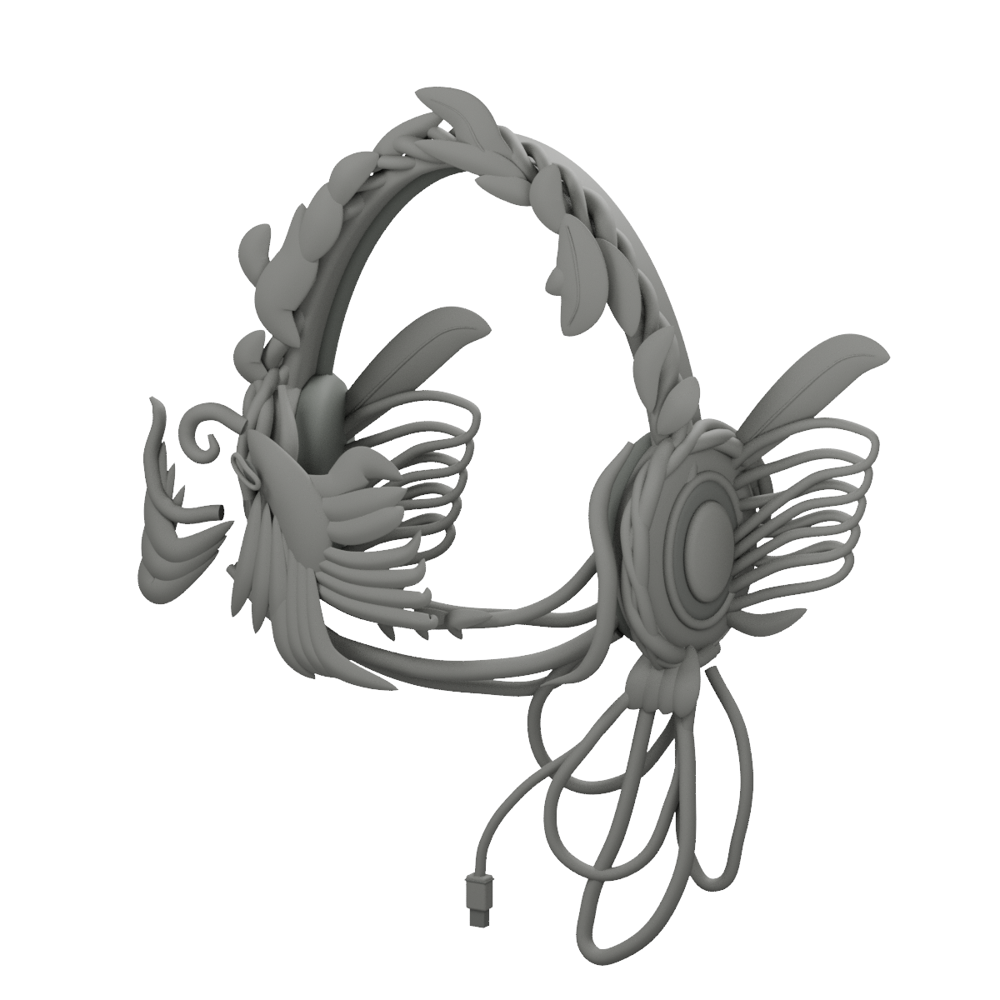

# Blender 耳机雕塑模型

依据参考图制作的灰色耳机外观模型，包含叶片头冠、羽翼装饰、编织藤蔓和悬垂线缆。Blender 文件保留独立网格和可编辑曲线。

## 下载

- **[下载完整文件包（ZIP）](https://github.com/taumzzx-del/Model/raw/refs/heads/main/blender_artifact/headset_package.zip)**：包含 Blender 模型、GLB、生成脚本、预览图和使用说明。
- **[下载 Blender 模型（.blend）](https://github.com/taumzzx-del/Model/raw/refs/heads/main/blender_artifact/sculptural_headset.blend)**：直接用 Blender 打开。
- [下载通用三维模型（GLB）](https://github.com/taumzzx-del/Model/raw/refs/heads/main/blender_artifact/sculptural_headset.glb)。

如果下载链接打开了文件页面，请使用页面上的 **Download raw file / 下载原始文件** 按钮。

## 查看模型

1. 在电脑上安装 [Blender](https://www.blender.org/download/)。
2. 下载完整文件包并解压，或直接下载 `.blend` 文件。
3. 在 Blender 中选择 **文件 → 打开**，打开 `sculptural_headset.blend`。
4. 按住鼠标中键拖动旋转视角，滚动滚轮缩放，按 `Shift` 加中键拖动平移。
5. 按 `F12` 渲染预览，完成后按 `F11` 返回。

[详细编辑说明及生成方法](blender_artifact/README.md)

模型基于单张参考图，隐藏面和背面按整体造型补全，尺寸未按实物标定。
